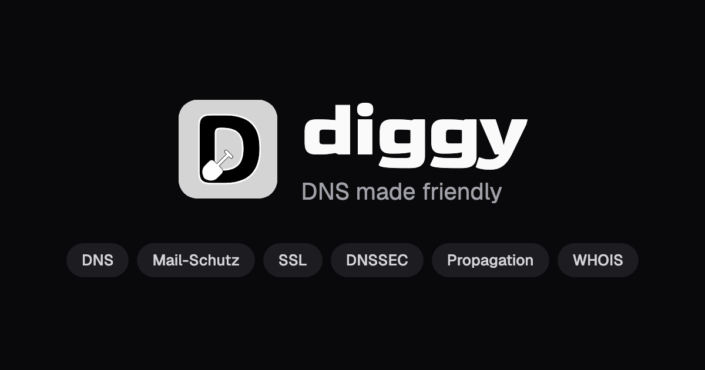
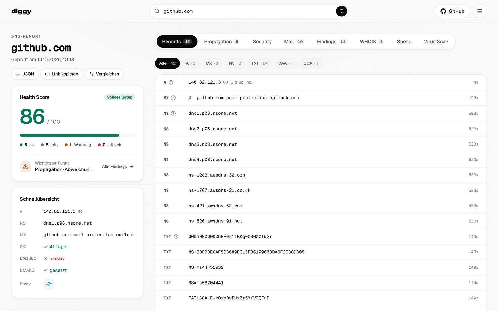
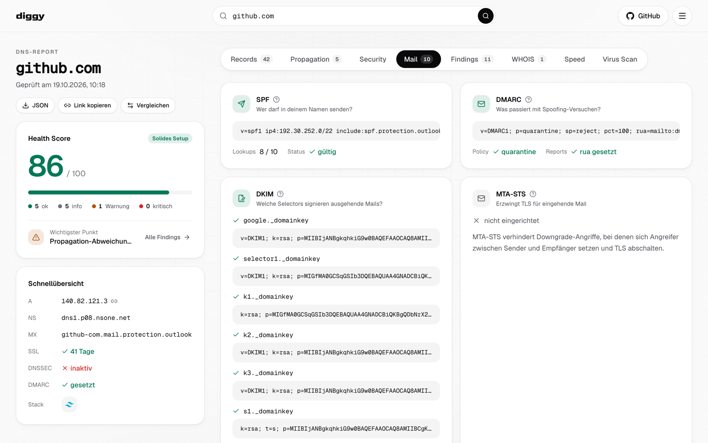
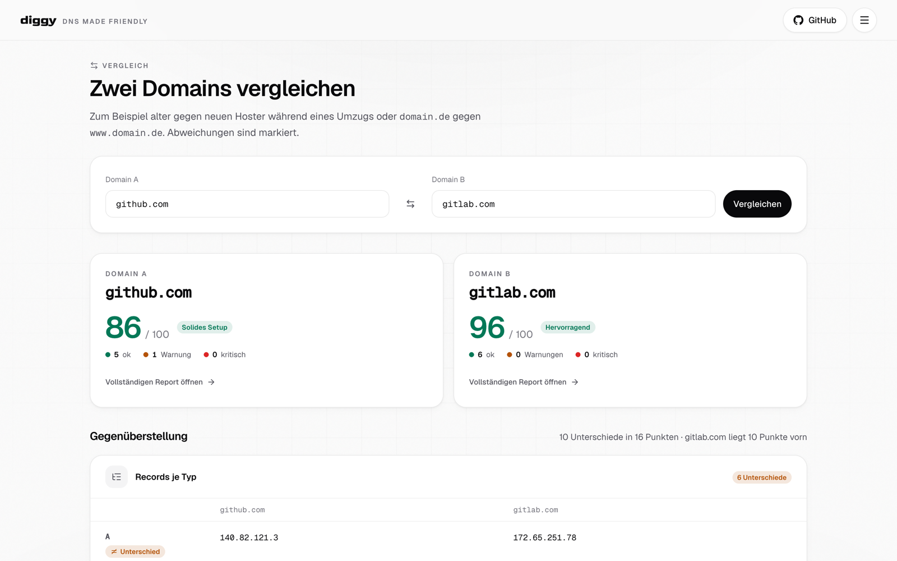
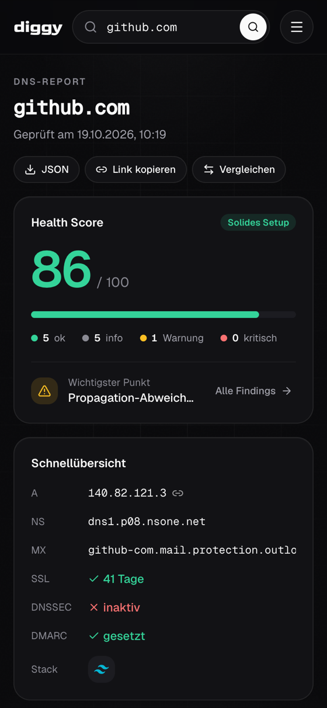

  

  <strong>Der DNS-Check, den man versteht.</strong> 
  Records, Mail-Schutz, SSL, DNSSEC, Propagation und WHOIS in einem Report — 
  mit Bewertung, Erklärung und konkreten Empfehlungen.

  <a href="https://diggydns.cloud"><strong>diggydns.cloud öffnen&nbsp;→</strong></a>

  
  
  
  

 

<picture>
  <source media="(prefers-color-scheme: dark)" srcset="docs/images/report-dark.png">
  
</picture>

## Was ist diggy?

Wer eine Domain betreut, kennt das Spiel: `dig` im Terminal, ein SSL-Checker im
nächsten Tab, ein Mail-Tester im dritten, ein WHOIS-Dienst für das Ablaufdatum —
und am Ende ein Haufen Rohdaten, die man selbst deuten muss.

**diggy macht daraus einen einzigen, verständlichen Report.** Domain eingeben,
und kurz darauf steht da, was eingerichtet ist, was fehlt und was man konkret
dagegen tun kann. Ein Health Score fasst alles in einer Zahl zusammen, jeder
Befund erklärt sich in einem Satz, und wo ein Eintrag fehlt, liefert diggy den
passenden Record nach Möglichkeit gleich mit.

Kostenlos, ohne Anmeldung, ohne Tracking — und Open Source.

## Warum diggy?

- **Alles in einem Report.** Records, Mail-Schutz, Zertifikat, DNSSEC,
  Propagation und WHOIS kommen aus einer Abfrage. Kein Tab-Hopping, kein
  Zusammensuchen.
- **Verständlich statt kryptisch.** Zu jedem Record-Typ und jedem Mail-Begriff
  gibt es eine Erklärung in Alltagssprache. Befunde sagen nicht nur, *was*
  fehlt, sondern *warum* es wichtig ist und wie die Lösung aussieht.
- **Ehrlich bewertet.** Der Health Score folgt festen, nachvollziehbaren Regeln
  auf Basis der einschlägigen RFCs. Scheitert eine Abfrage, steht dort „nicht
  prüfbar" statt eines falschen Alarms. Und eine Domain, die bewusst keine Mails
  empfängt, wird nicht für fehlenden Mail-Schutz bestraft.
- **Schnell.** Der Report baut sich auf, während die Antworten eintreffen.
  Langsame Checks wie WHOIS oder das Zertifikat halten den Rest nicht auf.
- **Privat.** Kein Konto, keine Cookies, kein Analytics. Verlauf, Theme und
  Sprache bleiben in deinem Browser.
- **Für jeden Bildschirm und jede Person.** Desktop und Mobil, hell und dunkel,
  Deutsch und Englisch, per Tastatur und Screenreader bedienbar — und wer
  „Bewegung reduzieren" eingestellt hat, bekommt keine Animationen.

## Was diggy prüft

| Bereich | Was du erfährst |
|---|---|
| **Records** | A, AAAA, MX, NS, TXT, CAA, SOA und CNAME mit echter TTL — und hinter jeder IP der Netzbetreiber. |
| **Mail-Schutz** | SPF inklusive Zählung der DNS-Lookups (RFC 7208), DKIM über 18 gängige Selektoren, DMARC mit der tatsächlich wirksamen Policy (RFC 7489), MTA-STS, TLS-RPT und BIMI. Domains ohne Mailempfang (Null-MX, RFC 7505) werden erkannt. |
| **SSL / TLS** | Zertifikat, Aussteller, Restlaufzeit und Kette — bevor Besucher eine Warnung sehen. |
| **DNSSEC** | Ist die Zone signiert und mit welchem Algorithmus — und bestätigen validierende Resolver die Signatur? |
| **Propagation** | Fünf öffentliche Resolver (Cloudflare, Google, AdGuard, NextDNS, DNS.SB) im Vergleich. Für Einträge wie `_dmarc` oder einen DKIM-Schlüssel auch per TXT und CNAME. |
| **WHOIS / RDAP** | Registrar, Registrierungs- und Ablaufdatum, Status und Nameserver. |
| **Tech-Stack** | Erkannte Webserver, CDNs, CMS und Frameworks der Website. |
| **Auf Klick** | PageSpeed (Google Lighthouse, mobil und Desktop) und die Reputation bei VirusTotal. |

### Der Health Score

Jeder Report startet bei 100 Punkten. Kritische Befunde kosten 25 Punkte,
Warnungen 8, Hinweise 2 — Hinweise zusammen höchstens 6, weil sie oft bewusst
gewählte Konfigurationen betreffen. Daraus ergibt sich das Urteil von
*Hervorragend* (ab 90) über *Solides Setup*, *Optimierbar* und *Lückenhaft* bis
*Kritisch*. Die Regeln stehen offen im Code
([`shared/scoring.ts`](shared/scoring.ts)) — keine Blackbox, keine KI.

## Mehr als ein Lookup

<table>
  <tr>
    <td width="50%" valign="top">
       
      <b>Mail-Schutz im Detail</b> — SPF, DKIM, DMARC und MTA-STS mit Bewertung und Erklärung.
    </td>
    <td width="50%" valign="top">
       
      <b>Zwei Domains vergleichen</b> — Unterschiede auf einen Blick, zum Beispiel beim Hoster-Umzug.
    </td>
  </tr>
</table>

- **Zwei Domains vergleichen.** Alter gegen neuen Hoster, `domain.de` gegen
  `www.domain.de`: Score, Records, Mail-Schutz, Zertifikat und DNSSEC
  nebeneinander, Unterschiede markiert — mit eigenem Link unter
  `/compare/<a>/<b>`.
- **Was hat sich geändert?** Prüfst du eine Domain erneut, zeigt diggy, was
  seit dem letzten Mal anders ist: neue oder entfallene Records, ein erneuertes
  Zertifikat, eine geänderte DMARC-Policy, ein besserer oder schlechterer Score.
- **Ablauf im Kalender.** Ein Klick erzeugt eine Kalenderdatei (`.ics`) für das
  Ablaufdatum von Zertifikat und Domain — mit Erinnerung 14 Tage und einen Tag
  vorher.
- **Teilen und exportieren.** Jeder Report hat einen festen Link mit eigener
  Vorschau in Slack, Teams und Messengern. Der komplette Report lässt sich als
  JSON herunterladen.
- **IP-Adressen nachschlagen.** Eine IPv4- oder IPv6-Adresse eingeben und
  Reverse DNS (PTR), Netz, ASN und Standort sehen.
- **Domain noch frei?** Der Verfügbarkeits-Check prüft einen Namen und schlägt
  gängige Alternativen (`.de`, `.com`, `.io`, `.net`, `.app`, `.dev`, `.org`)
  gleich mit vor.

  

## Typische Fragen, die diggy beantwortet

- *„Warum landen meine Mails im Spam?"* — Der Mail-Tab zeigt, ob SPF, DKIM und
  DMARC zusammenpassen und was fehlt.
- *„Ist der Umzug zum neuen Hoster schon überall angekommen?"* — Propagation
  und Vergleich zeigen, welche Resolver noch die alten Werte liefern.
- *„Ist der neue DKIM-Schlüssel live?"* — `selector._domainkey.domain.de`
  eingeben, und die Propagation vergleicht den TXT-Eintrag über alle Resolver.
- *„Wann läuft mein Zertifikat ab — und die Domain?"* — Restlaufzeiten stehen
  im Report, die Erinnerung kommt per Kalenderdatei.
- *„Ist meine Domain sauber konfiguriert?"* — Der Health Score sagt es in einer
  Zahl, die Findings sagen, was zu tun ist.

## Datenschutz und Sicherheit

- **Kein Konto, keine Cookies, kein Tracking, keine Werbung.** Schriften werden
  selbst ausgeliefert, im Browser lädt diggy nichts von Drittanbietern.
- **Kaum Daten auf dem Server.** Abfrageergebnisse liegen nur kurz im
  Zwischenspeicher, für DNS-Lookups 60 Sekunden. Der Verlauf deiner Abfragen
  bleibt ausschließlich in deinem Browser.
- **Gehärtet für den öffentlichen Betrieb.** Schutz gegen Missbrauch als
  Angriffswerkzeug (SSRF), Rate-Limits und eine strenge Content-Security-Policy.
- **Gehostet in Deutschland** bei mittwald.

Die Details stehen in den
[Datenschutzhinweisen](https://diggydns.cloud/datenschutz) und in
[docs/COMPLIANCE.md](docs/COMPLIANCE.md).

## Unter der Haube

diggy ist eine TypeScript-Anwendung aus einem Guss: React 19 und Tailwind CSS 4
im Browser, Express 5 auf Node.js 24 im Backend, DNS-Abfragen über das System
und über DNS-over-HTTPS. Jede Änderung durchläuft Unit- und Integrationstests
sowie Browser-Tests mit Pixelvergleich in hellem und dunklem Theme, auf Desktop
und Mobil.

Wer am Code mitarbeiten oder diggy selbst betreiben möchte, findet alles in
[docs/DEVELOPMENT.md](docs/DEVELOPMENT.md) und
[docs/DEPLOYMENT.md](docs/DEPLOYMENT.md).

## Mitmachen

Ideen, Fehlerberichte und Pull Requests sind willkommen. Am einfachsten startest
du mit einem [Issue](https://github.com/shadowfps/diggy-easydns/issues) —
gerade bei größeren Änderungen lohnt es sich, die Idee vorher kurz abzustimmen.

## Lizenz

MIT
